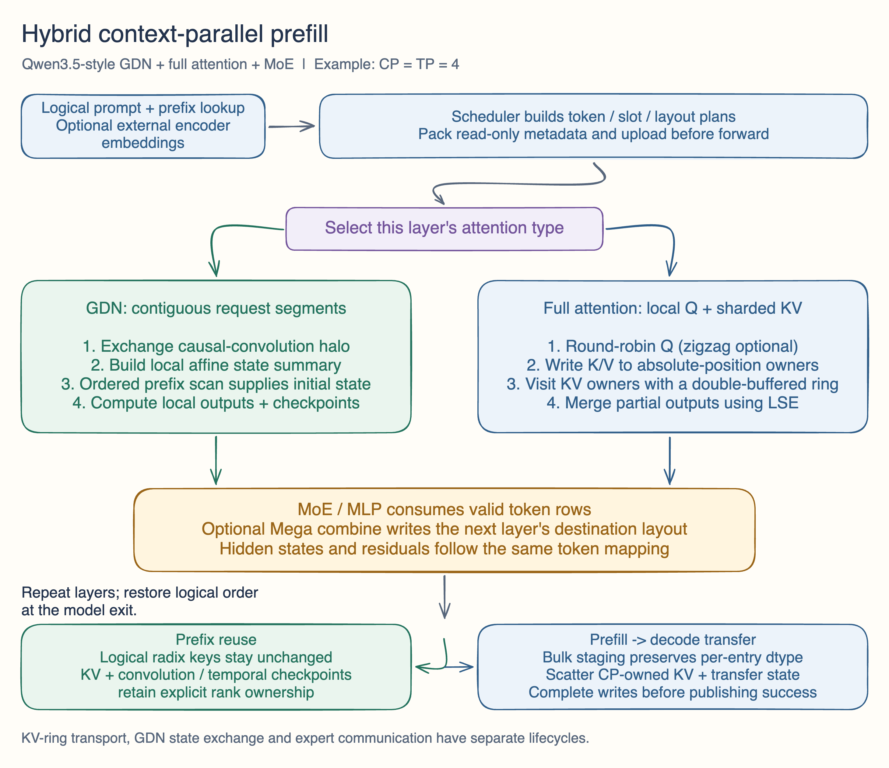
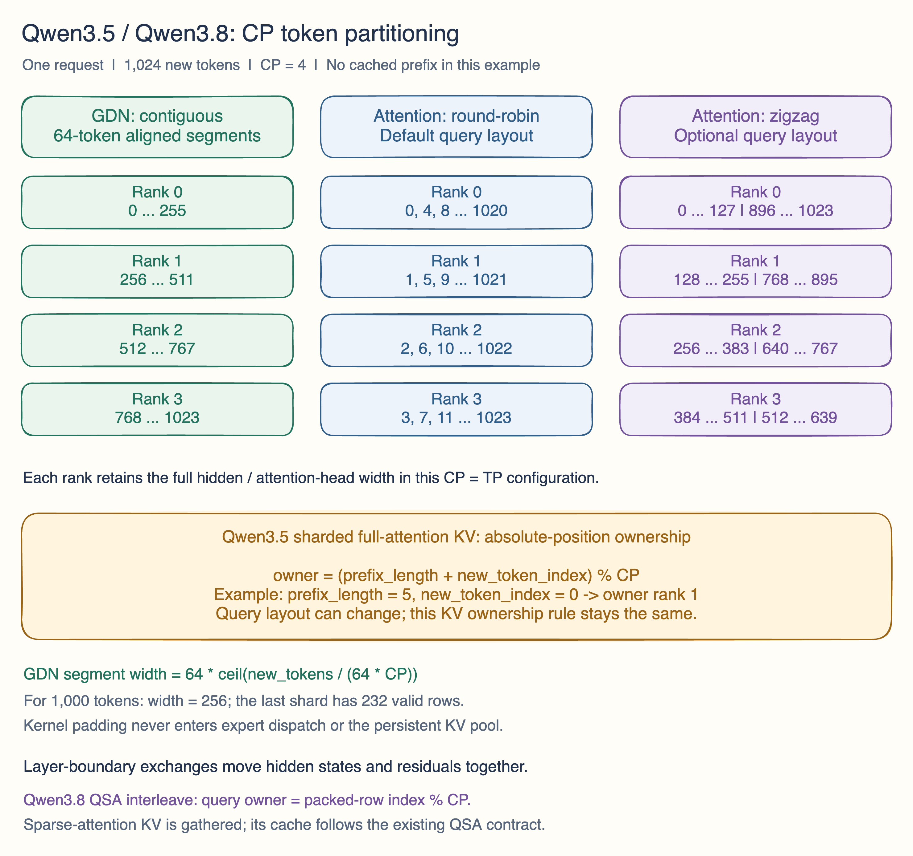

## Motivation

Add context-parallel prefill for **Qwen3.5 and Qwen3.8**, covering their hybrid gated delta network (GDN), full/sparse attention and MoE execution. Long prompts need sequence sharding across these layers while preserving causal recurrence, query/KV correspondence, prefix-cache reuse and prefill-to-decode transfer.

The shared design is described in [Qwen3.5 Context Parallel: system design and computation flow](https://wulinze.github.io/llm/qwen35-context-parallel/) (Chinese). This PR includes both model integrations and their runtime, cache and transfer support. Qwen3.8 enters through the repository's existing `qwen4_exp` implementation, including QSA/indexer and model-specific residual/PLE handling.

**Draft:** CPU regression checks are available below. Multi-GPU numerical accuracy, model-level evaluation and performance measurements for this head are still pending.

## Modifications



[Editable Excalidraw flow diagram](https://github.com/wulinze/sglang/blob/b0b4589c1c5708d72acea79f187edd784b1c7582/hybrid-cp-flow.excalidraw)

### Token partitioning and layer boundaries

CP partitions token rows. In the `CP = TP` configuration, attention TP is one, so a rank retains the full hidden/head width for its local rows. Query ownership and KV storage follow each attention backend's contract:

| Consumer | Partition | Reason |
| --- | --- | --- |
| GDN | Per-request contiguous segments, with a segment width rounded up to a multiple of 64 | Preserve temporal order and kernel chunk boundaries |
| Full-attention queries | Round-robin by absolute token position by default; zigzag is also supported | Distribute causal attention work across ranks |
| Qwen3.5 sharded full-attention KV | Absolute token position modulo CP size | Keep ownership stable across prefix hits, chunk boundaries and query-layout changes |
| Qwen3.8 QSA queries | Interleaved rows from the packed batch; zigzag remains supported | Keep local queries aligned with the CP/indexer plan |
| Qwen3.8 sparse-attention KV | Gather fresh K/V and combine with cached prefix under the existing QSA cache contract | Preserve exact sparse top-k positions and fresh BF16 values |
| MoE / MLP | Valid rows from the current layout; output can target the next layer's layout | Preserve routing semantics while avoiding a separate layout exchange where supported |



[Editable Excalidraw partition diagram](https://github.com/wulinze/sglang/blob/b0b4589c1c5708d72acea79f187edd784b1c7582/cp-token-partitions.excalidraw)

For `N` new tokens and `C` CP ranks:

```text
GDN segment width = 64 * ceil(N / (64 * C))
Sharded full-attention KV owner for new token i = (prefix_length + i) % C
QSA interleaved query owner = packed_new_token_row % C
```

For example, 1,000 new tokens on four ranks use a segment width of 256; the last GDN shard has 232 valid rows. Kernel padding is excluded from expert dispatch and persistent KV storage. In the sharded full-attention path, round-robin queries use the same prefix-aware ownership as new KV writes, allowing the corresponding redistribution to be skipped. Zigzag changes query ownership and packing while retaining that KV ownership rule. QSA's interleave layout instead uses the packed new-token stream; its query positions include each request's prefix for causal scoring.

The scheduler prepares a batch-owned plan for token routes, lengths and indices, packs read-only metadata into a pinned upload, and resolves cache slots from the device request table. Existing layer-boundary preparation/output hooks move hidden states and residuals using the same mapping. Model exit restores logical token order.

### GDN recurrence and full attention

GDN CP enters through the existing linear-attention backend's prefill dispatch using FlashQLA. It exchanges the causal-convolution halo separately from the recurrent state, computes a local affine state summary, and combines preceding summaries in sequence order to supply each shard's initial state.

For one head, `S` and `H` have shape `[dk, dv]` and `M` has shape `[dk, dk]`; `@` denotes matrix multiplication:

```text
F_r(S) = M_r @ S + H_r
F_b(F_a(S)) = (M_b @ M_a) @ S + (M_b @ H_a + H_b)
```

Composition is associative but order-sensitive. Cached prefix state supplies the starting state; an empty shard contributes the identity transformation. Convolution and temporal checkpoints retain their ownership for later prefix reuse and PD transfer.

Full attention keeps Q local and visits the persistent KV shards through a double-buffered ring. Existing FA3/TRT-LLM attention kernels produce partial outputs and log-sum-exp (LSE) values. These are merged with stable LSE weights, preserving causal masking by global position. KV-ring transport is selectable through `--attn-cp-transport nccl|symm_rma`; its resources are distinct from GDN state exchange and expert communication.

### Qwen3.8 QSA and model integration

The `qwen4_exp` model connects its GDN layers to the same FlashQLA CP dispatcher and contiguous row transport. Its QSA layers retain the existing sparse-attention/indexer entry points, using round-robin queries and an index-key ring for the interleave path. Sparse attention gathers fresh K/V once, restores token order and packs each request's cached prefix. Fused packing/cache stores preserve fresh BF16 inputs even when the cache uses FP8 or cache writes are disabled, together with absolute causal positions and logical top-k indices. The QSA index-key ring and the full-attention KV ring carry different data and serve different computations.

Model integration also handles strided GDN projections, external-encoder embeddings, full-head state/checkpoint ownership and native MXFP4 Mega execution through the existing loading/quantization path. Layer-boundary plans route attention/MoE outputs and residual or mHC streams to the next layer's layout; PLE operations that need global sequence order gather the relevant rows and select the rank-local result. Backend metadata and enabled-kernel warmup are prepared through the existing batch and ModelRunner paths.

### Runtime and serving integration

| Area | Changes and review entry points |
| --- | --- |
| Layouts and execution boundaries | Reusable token exchange/gather plans in `layers/cp/utils.py`; integration through `layers/layer_boundary/`, the hybrid attention backend and model forwards |
| Model integration | Qwen3.5 in `models/qwen3_5.py`; Qwen3.8 in `models/qwen4_exp.py`, with QSA/indexer changes in `layers/attention/qwen_sparse_attn_backend.py` and `layers/attention/qsa/` |
| Kernels and communication | Fused QK normalization/RoPE/gating and GDN projection preparation; shared communication buffers and lifecycle handling in `TorchSymmMemCommunicator` |
| MoE | Integrate optional SM90 MXFP4 Mega execution through the existing MoE/quantization path. Mapped combine output and asynchronous residual exchange target the next layer's layout while preserving expert IDs, top-k weights and shared-expert semantics |
| Cache and allocation | Shard logical KV and Mamba checkpoint storage, preserve logical radix keys, and track compatible KV/state boundaries for prefix hits |
| PD transfer | Bulk staging with per-entry byte sizes/dtypes, target/draft KV slot matching, CP page gather/scatter, state-owner selection and completion ordering; handle unwritten staging rows in the fallback path |
| Scheduling and warmup | Chunked and external-encoder multimodal prefill integration; reserve communication/expert workspaces before KV budgeting and run compilation/tuning through ModelRunner |
| Observability and routing | Runtime/HTTP profiling controls and execution ranges; stable worker selection and consistent hash-ring membership updates in the gateway to preserve session/cache locality |

### Current scope and dependencies

The sharded GDN path currently validates `CP = TP >= 2`, PD prefill with Mooncake, and `DP = attention-DP = PP = MoE-DP = DCP = 1`. It requires BF16 model execution, GDN key/value head dimensions of 128, a page size divisible by CP and explicit `max-running-requests`. Multimodal use requires an external encoder and a language-only prefill worker. This path runs eagerly; speculation, LoRA, HiCache and the incompatible state-compression/memory modes are rejected by argument validation.

MoE TP and EP are resolved separately from CP. The optional SM90 MXFP4 Mega path requires single-node pure EP with `CP = EP = TP`, NVSHMEM and compatible FlashInfer SM90 staging/megakernel APIs. These external APIs still need version-compatibility validation; enabling CP alone does not enable Mega. The new `flashqla` optional dependency pins `flash-qla==0.1.3`.

## Accuracy Tests

Validation for code head `6ce47b3dd20136dd0cfcf6154a2fb7037e37ad84`, on macOS with Python 3.12 / CPU Torch:

| Check group | Result |
| --- | --- |
| Selected QSA / CP regression suites | 104 passed, 348 skipped, 13 CUDA-only cases deselected |
| Disaggregation wire, bootstrap, batching and bulk-transfer regressions | 128 passed; 153 subtests passed |
| Server argument regressions | 372 passed; 278 subtests passed; 3 environment-dependent cases deselected |
| Changed Python files | 124 compiled successfully |
| Pre-commit | Runnable checks passed; gateway rustfmt skipped because the Rust toolchain is unavailable |

Total: **604 passed tests**, plus 431 passing subtests. The three server-argument exclusions require unavailable MLX/xgrammar components and also failed on the unchanged base in the same environment. CUDA-dependent tests were skipped/deselected; these results do not establish multi-rank numerical correctness. The gateway changes have not been built or tested with Rust here.

Before marking ready for review:

- [ ] Run GPU kernel and multi-rank CP comparisons, including round-robin/zigzag, ragged/empty shards, nonzero prefixes and chunk boundaries.
- [ ] Validate GDN convolution/state checkpoints and end-to-end PD reconstruction, including mixed KV dtypes and target/draft layouts.
- [ ] Run Qwen3.5 and Qwen3.8 model-level accuracy against matching non-CP baselines, plus the gateway Rust checks.

## Speed Tests and Profiling

No speedup numbers are claimed for this head. The design article explains the computation/communication structure; it is not benchmark evidence for this PR.

Pending measurements should compare matched model weights, quantization, hardware and request workloads across CP sizes, with cold/warm prefix caches and short/long incremental prefill. Report TTFT, prefill throughput, memory usage and PD transfer time, and use the added profiling ranges to inspect metadata upload, GDN state/halo exchange, the KV ring, expert dispatch/combine and residual layout exchanges.

## Checklist

- [x] Add or extend focused regression tests and GPU test coverage in the test tree.
- [x] Describe CP partitioning and execution flow, with editable diagrams.
- [ ] Complete GPU accuracy and performance validation.
- [ ] Validate external FlashInfer/NVSHMEM compatibility for the optional Mega path.
- [ ] Complete gateway Rust formatting/build/tests and required community CI.
- [ ] Add user-facing deployment documentation once the validated configuration is established.
