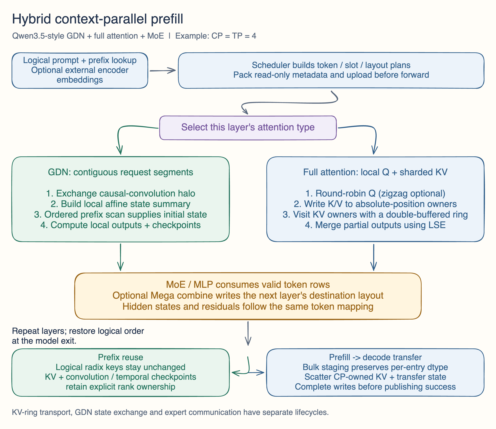
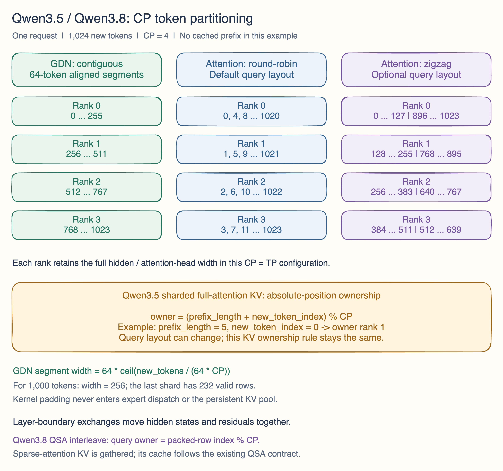

## Motivation

Add context-parallel prefill for **Qwen3.5 and Qwen3.8**, preserving causal GDN state, attention token order, prefix reuse and PD transfer. Qwen3.5 uses `qwen3_5.py`; Qwen3.8 uses the existing `qwen4_exp.py` and QSA/indexer path.

Design: [original article](https://wulinze.github.io/llm/qwen35-context-parallel/) and [implementation notes](https://github.com/wulinze/sglang/blob/docs/qwen35-cp-pr-diagrams/pr-body.md).

**Validation:** GPU numerical checks, Qwen3.5/Qwen3.8 model accuracy and complete serving-path tests were completed during development. This PR ports that validated implementation; the results below retain their original test revisions, alongside regression checks on the community PR head.

## Modifications

### CP partitioning

- **GDN, both models:** contiguous segments aligned to 64 tokens; convolution-halo exchange, ordered affine-state prefix composition, FlashQLA prefill and owned convolution/temporal checkpoints.
- **Qwen3.5 full attention:** local round-robin Q (zigzag also supported), persistent KV ownership by absolute position, a double-buffered KV ring and causal FA3/TRT-LLM attention with LSE-weighted output merging.
- **Qwen3.8 QSA:** queries interleaved over packed token rows, index-key ring and sparse top-k selection. Gather fresh sparse-attention KV once and pack cached prefixes while preserving fresh BF16 values and causal positions. Its cache contract differs from the full-attention KV ring.

For `N` new tokens and `C` ranks:

```text
GDN segment width = 64 * ceil(N / (64 * C))
Sharded full-attention KV owner = (prefix_length + new_token_index) % C
QSA interleaved query owner = packed_new_token_row % C
```

Padding stays out of expert dispatch and KV storage. Layer boundaries apply matching hidden/residual/mHC row plans, preserve Qwen3.8 PLE global-order requirements and restore logical output order.





[Editable Excalidraw sources](https://github.com/wulinze/sglang/tree/b0b4589c1c5708d72acea79f187edd784b1c7582).

### Symm integration

Reuse `TorchSymmMemCommunicator` for group/device peer workspaces independently of its optional all-reduce path.

- `--attn-cp-transport nccl|symm_rma` selects full-attention KV and QSA index-key ring transport. Separate workspaces, double buffers, arrival/credit signals and stream dependencies protect payload reuse.
- GDN publishes affine summaries for ordered peer-prefix computation and uses owner-based multicast state broadcast when supported. Collective startup capability checks select NCCL state communication when multicast prerequisites are unavailable.
- Residual/layout exchange uses precomputed peer-row ranges and persistent buffers on a separate stream; mapped Mega output uses Torch symmetric peer destinations. These paths retain distinct lifecycles from Mega's NVSHMEM buffers.

### MegaMoE integration

Enable with `--enable-mxfp4-mega --moe-a2a-backend megamoe`. Reuse FusedMoE and quantization interfaces: native MXFP4 via Humming, or explicit W4AFP8 INT4-to-MXFP4 requantization and weight packing. The serving evaluations below cover the tested Mega configurations; an isolated conversion-versus-original-weight accuracy comparison remains follow-up work.

SGLang preserves routing, expert IDs/top-k weights and shared-expert semantics; FlashInfer stages activations/routing and executes SM90 experts with NVSHMEM. Mapped combine receives destination rank/row indices and peer pointers, incorporates shared outputs/gates and writes the next layer's layout directly. Residual/mHC uses the same row plan. Expert communication still occurs.

ModelRunner reserves bounded workspaces before KV budgeting, agrees on geometry/tactics across ranks and warms launch variants. Serving reuses these buffers on their bound stream; borrowed outputs must be consumed before reuse, and empty ranks still participate.

### Serving support

Prebuild batch metadata and packed uploads; integrate fused projection/RoPE/gating, logical radix keys and checkpoint ownership, bulk PD staging with per-entry dtypes and target/draft KV matching, CP gather/scatter and completion ordering. Also integrate chunked/external-encoder prefill, profiling ranges and stable gateway worker selection.

## Current limitations

- **Topology:** PD prefill using Mooncake/Mooncake TCP; `CP = TP >= 2`; `DP = attention-DP = PP = MoE-DP = DCP = 1`. No attention head sharding or pipeline composition for this path.
- **GDN:** SM90/SM100/SM103, BF16, key/value head dimensions 128; `flash-qla==0.1.3`, `tilelang>=0.1.12`. Explicit positive request capacity and page size divisible by CP; QSA interleave needs a positive prefill chunk size.
- **Execution:** eager only; external encoder plus language-only worker for multimodal. No inline vision, speculation, LoRA, HiCache, unified memory, INT8 Mamba checkpoints, linear ReplaySSM or memory saver. FA3 still rejects FP8 E5M2.
- **Symm:** peer RMA requires one host and Torch CUDA symmetric allocation. GDN multicast additionally requires 2/4/8 ranks and multicast/stream-memory capabilities on every rank. Its NCCL fallback does **not** cover explicitly selected ring RMA: unsupported `symm_rma` raises an error; select NCCL instead.
- **New MXFP4 Mega path:** SM90, single-node pure EP, `CP = EP = TP`, `MoE-TP = 1`; NVSHMEM and compatible FlashInfer SM90 APIs required. Only supported MXFP4 or explicit W4AFP8 conversion inputs; no TBO/SBO. External API/version compatibility remains to be validated.

## Accuracy Tests

[Validation details and aggregate evidence](https://github.com/wulinze/sglang/blob/docs/qwen35-cp-pr-diagrams/accuracy-validation.md).

### Model accuracy through the serving API

These are completed development runs through the service endpoint, including CP prefill, PD transfer and decode. They are fixed 200-example evaluations, not full-dataset scores.

| Model / tested revision | Serving configuration | GSM8K | MMLU |
| --- | --- | --- | --- |
| Qwen3.5-397B-A17B, `375c257815` (Oct 22) | CP4 + Mega; external encoder and separate decode | 196/200 (98.0%) | — |
| Qwen3.5-397B-A17B, `1458f458c8` (Oct 25) | CP4 + Mega on 4× H800 prefill; concurrency 8, non-thinking | 196/200 (98.0%) | — |
| Qwen3.8, fused-QSA candidate subsequently consolidated into `5454a9c682` (Nov 3) | CP2 + Mega, PD; concurrency 8, non-thinking | 192/200 (96.0%) | 177/200 (88.5%) |
| Qwen3.8, `5454a9c682` (Nov 4) | Two CP2 + Mega prefill workers and one 4-GPU decode worker; concurrency 64, template-default thinking | **194/200 (97.0%)** | **176/200 (88.0%)** |

Protocol: GSM8K 5-shot; Qwen3.8 MMLU 0-shot, fixed 200 questions covering 49 subjects. Temperature 0, top-p 1 and seed 0 for the Oct 25/Nov 3/Nov 4 runs; output limits were 4,096 tokens for the non-thinking runs and 16,384 for the Nov 4 run. Score extracted final answers; request failures, missing final answers and truncations count as incorrect. No retries or selective replacement of failed answers.

All 400 requests in the Nov 4 evaluation returned HTTP 200, and workers remained healthy afterward. The reported scores include six empty final answers and five truncated responses as failures. Nov 3 also had zero request errors; its truncated and invalid answers remain in the denominator. The two Qwen3.8 runs use different thinking/output-budget settings and are not a like-for-like accuracy comparison.

### Complete end-to-end serving and GPU checks

- **Qwen3.5 EPD:** six CP4 + Mega prefill groups, separate 8-GPU decode and an external encoder. All **15 functional cases** passed, including a **70,311-token retrieval request**, short generation, image requests and cached follow-up turns. Eight additional routing requests covered all six prefill groups; post-run queues drained. Concurrent shared-prefix checks also passed, with observed **50,048-token cache hits**.
- **Sustained serving:** the same Qwen3.5 development campaign completed **6,462/6,462 requests**, zero failed requests, over **30 minutes** at 3.59 requests/s (mean input 51,839 tokens). This exercises the full serving chain and is a reliability result, not a claim of CP speedup or maximum capacity. NEXTN was enabled on the separate decode service; this does not enable speculative execution inside the CP prefill path.
- **Qwen3.8 PD and prefix reuse:** the fused-QSA campaign completed end-to-end accuracy requests and cold/repeated/branched-prefix checks. A 19,027-token repeated prompt reused **19,008 cached tokens**; branching after token 8,192 reused **8,192 cached tokens**, with expected generated answers.
- **GPU regressions:** the fused-QSA run recorded **192 passed** GPU cases, plus a separate **16 passed** cache-store regression run (counts are separate runs, not asserted to be disjoint).
- **Mapped Mega/mHC combine:** **368/368** comparisons against explicit combine + reorder were elementwise identical (`max_abs = 0`, `max_relative_rms = 0`) on real model inputs. This validates that layout transformation; it is not a blanket equivalence claim for quantization conversion.

The community submission retains this development validation. Its commit rewriting, refactoring and upstream API adaptations are accompanied by the head checks below; the historical GPU runs are not presented as a new run of SHA `6ce47b3dd2`.

### Community-head regression checks

Head `6ce47b3dd2`, Python 3.12 / CPU Torch on macOS: **604 passed tests** (104 QSA/CP + 128 disaggregation + 372 server-argument tests), plus 431 passing subtests. CUDA cases: 348 skipped, 13 deselected. Three MLX/xgrammar-dependent argument cases were excluded after reproducing failures on the unchanged base.

All 124 changed Python files compiled; runnable pre-commit checks passed. Gateway Rust formatting/build/tests and community CI remain outstanding. Matching non-CP accuracy baselines, an isolated quantization-conversion comparison and an upstream-reproducible FlashInfer/NVSHMEM dependency matrix remain follow-up coverage.

## Speed Tests and Profiling

The 30-minute end-to-end load run above establishes completed serving coverage. No general CP speedup is claimed: matched weights, quantization, hardware and request workloads are required for that comparison. Follow-up profiling should quantify TTFT/throughput/memory/transfer cost and actual communication/computation overlap across CP sizes and cold/warm prefixes.

## Checklist

- [x] Add or extend regression/GPU tests and explain both model paths with diagrams.
- [x] Complete development GPU/model accuracy and end-to-end EPD/PD serving validation; record configurations, revisions and scoring boundaries.
- [x] Run community-head CPU regression and Python checks.
- [ ] Complete matched non-CP/conversion comparisons, upstream dependency reproducibility, gateway Rust checks and community CI.
